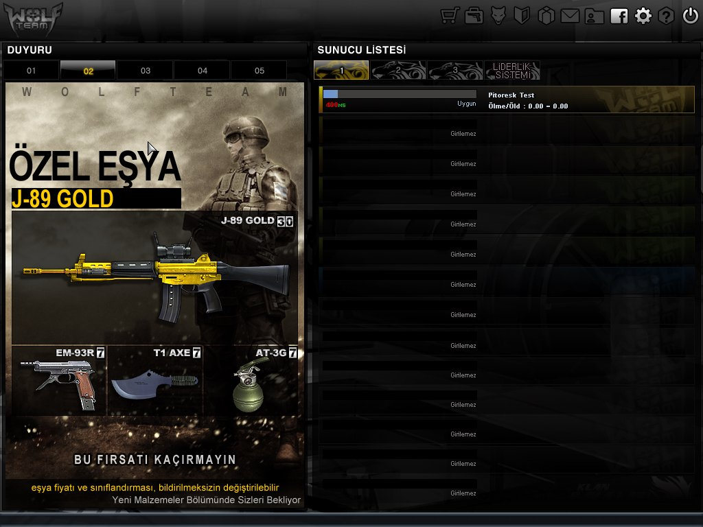
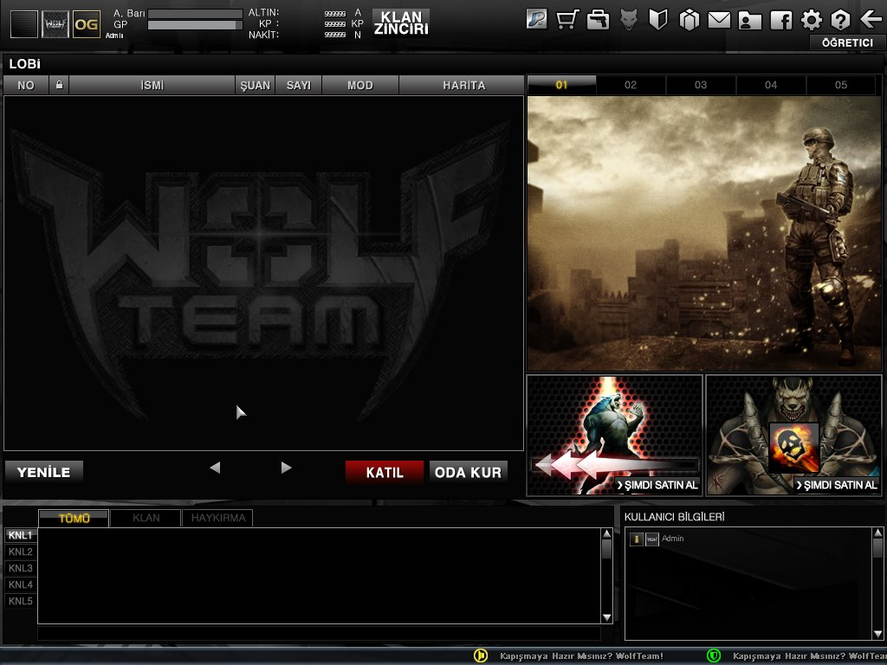
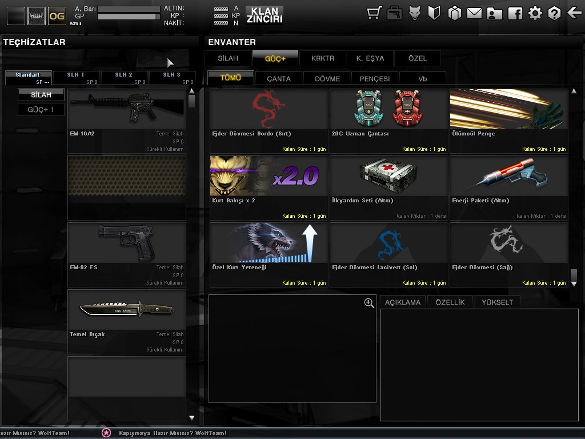
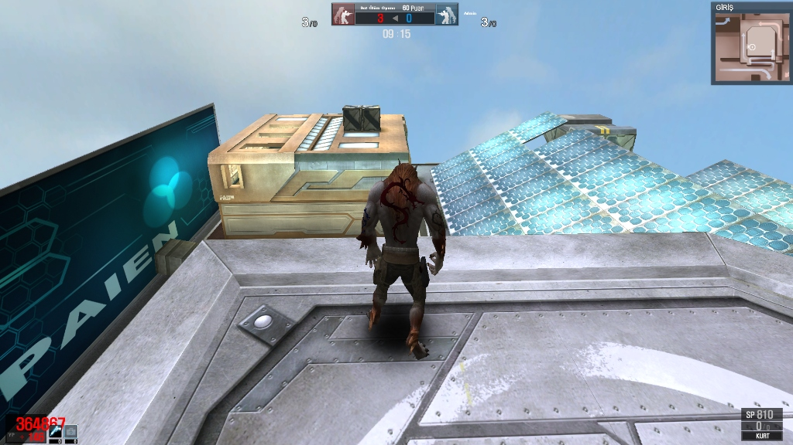
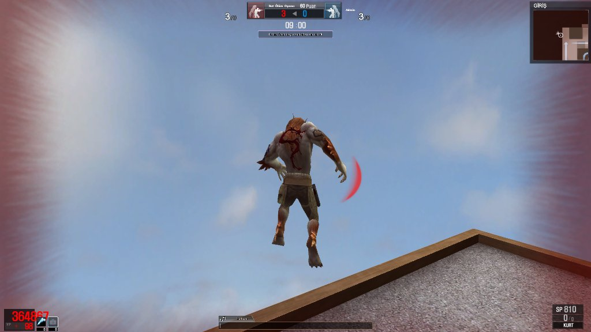

# WolfTeam 2013 / 2012 TR Private Server (Go + PostgreSQL)

Go (`1.25+`) ve PostgreSQL (`17`) tabanlı, **WolfTeam 2013 TR** ve **Eylül 2012 TR** istemcilerini tek sunucu çekirdeğinde destekleyen açık kaynaklı özel sunucu yığını.

> **English Summary:** Open-source Go 1.25 + PostgreSQL 17 game server stack supporting both **WolfTeam 2013 TR** (default) and **September 2012 TR** clients via `WT_CLIENT_2012=true`. Includes Docker Compose deployment, native Windows/VDS setup scripts, 48 SQL schema migrations, a Python Tkinter launcher for 2013 TR, and a Windows C# WinForms launcher with Avital HTTP `206 Partial Content` bypass and safe Loopback-only broker relay for 2012 TR clients.

---

## Ekran Görüntüleri

Canlı VDS sunucusu üzerinde test edilmiş oyun içi görüntüler:

| Sunucu Listesi | Lobi & GM (`OG`) Rozeti |
|---|---|
|  |  |

| Envanter & Teçhizatlar | Oyun İçi (Giriş / Kurt) |
|---|---|
|  |  |

<p align="center">
  
</p>

---

## Özellikler

- **Tek İkili Sunucu Mimarisi (`wtserver`):** Broker, Game TCP/UDP, Bot Peer Bootstrap, Buddy/Arkadaşlık, NAT/Relay UDP, Oyun İçi Sıralama (Ranking Web), Launcher TLS Auth ve HTTP Patcher/Kayıt (`/register`, `/healthz`) servislerinin tamamını tek Go sürecinde çalıştırır.
- **2013 TR + Eylül 2012 TR Çift Protokol Desteği:**
  - `WT_CLIENT_2012=false` (varsayılan): Tam 2013 TR paket düzeni, W-Pack, Premium Dükkan, Klan/Pride, Dereceli/Klan kanalları.
  - `WT_CLIENT_2012=true`: Eylül 2012 TR istemcisiyle uyumlu paket düzeni (oda kurma/listeleme, oda içi oyuncu listesi, hazır/başlat/çıkış akışı, AI bot maçları, kanal sohbeti, market/envanter, maç sonu ödül ekranları).
- **Tam Kalıcı Veritabanı (PostgreSQL 17):** `docker/postgres.sql` + `48` adet idempotent SQL migrasyonu (`docker/migrations/002..048`).
- **İki Hazır Başlatıcı (Launcher):**
  - [`client-launcher/`](client-launcher/README.md): 2013 TR istemcisi için hesap kayıt destekli Python Tkinter başlatıcı.
  - [`launcher/`](launcher/README.md): Visual Studio gerektirmeden derlenen, 2012/2013 TR istemcileri için Avital `update.u` HTTP 206 bypass ve güvenli Loopback broker yönlendirmeli Windows C# başlatıcı.
- **Yönetim Aracı (`wtadmin`):** Komut satırından güvenli hesap oluşturma ve şifre değiştirme.

---

## Depo Yapısı

```text
.
├── docker/
│   ├── compose.yaml          # PostgreSQL 17 + migrate + game + ladder + pride servisleri
│   ├── .env.example          # Örnek ortam değişkenleri şablonu
│   ├── postgres.sql          # Temel veritabanı şeması ve başlangıç kanalları
│   ├── migrations/           # 002..048 arası SQL migrasyonları
│   ├── apex-web/             # İsteğe bağlı Avital/Apex statik dosyaları
│   └── patches/              # İsteğe bağlı proje-kaynaklı yama dosyaları
├── go-gameserver/
│   ├── cmd/
│   │   ├── wtserver/         # Ana oyun sunucusu
│   │   ├── wtadmin/          # Hesap/şifre yönetim CLI aracı
│   │   └── wtload/           # Yük testi aracı
│   ├── internal/             # Broker, Game, Buddy, Launcher, Patcher, Store, Crypto
│   ├── LICENSES/             # Go ve üçüncü parti kütüphane lisans bildirimleri
│   ├── Dockerfile            # Çok aşamalı Go 1.25 -> Alpine 3.22 imajı
│   └── *.dat / bf_schedule.bin
├── launcher/                 # Windows C# WinForms başlatıcı (2012 & 2013 TR)
├── client-launcher/          # Python Tkinter başlatıcı (2013 TR + /register)
├── notice/                   # Oyun içi duyuru ve metin tabloları
├── tools/                    # Yardımcı Python araçları
├── docs/
│   ├── KURULUM.md            # Ayrıntılı Türkçe kurulum ve sorun giderme rehberi
│   ├── start-windows.example.ps1
│   ├── screenshots/          # Canlı sunucu ekran görüntüleri
│   └── data/                 # Referans CSV tabloları
└── LICENSE.md                # MIT Lisansı
```

---

## Hızlı Başlangıç (Docker Compose)

> **Not:** Bu depo yalnızca sunucu ve açık kaynak başlatıcı kodlarını içerir; telifli oyun istemci dosyalarını dağıtmaz.

1. Örnek ortam dosyasını kopyalayın ve şifre/IP alanlarını düzenleyin:
   ```bash
   cp docker/.env.example docker/.env
   ```
   - Yerel test için `ADVERTISED_IP=127.0.0.1` ve `PUBLIC_IP=127.0.0.1` bırakabilirsiniz.
   - VDS / uzak sunucu için her iki alana sunucunun genel IPv4 adresini yazın (ör. `203.0.113.10`).
   - Eylül 2012 TR istemcisi kullanacaksanız `WT_CLIENT_2012=true` ve `WT_WPACK_ENABLED=false` yapın.

2. Yığını başlatın:
   ```bash
   cd docker
   docker compose up -d --build
   ```

3. Sunucunun ayağa kalktığını doğrulayın:
   ```bash
   curl http://127.0.0.1:8080/healthz
   ```

---

## Ayrıntılı Kurulum Rehberi

- **Native Windows Server / VDS kurulumu** (Docker olmadan PostgreSQL 17 Windows Servisi + Go derleme + Firewall + Cloud VCN kuralları),
- **2012 TR vs 2013 TR istemci farkları ve başlatıcı ayarları**,
- **Hesap oluşturma, GM (`authority = 12`) yetkisi verme ve güvenlik kontrol listesi**,
- **Sık karşılaşılan hatalar ve çözümleri**

için ayrıntılı rehbere bakın: **[`docs/KURULUM.md`](docs/KURULUM.md)**.

---

## Temel Portlar

| Port | Protokol | Servis | Açıklama |
|---|---|---|---|
| `40706` | TCP | Broker | Sunucu/kanal listesi |
| `40707` | TCP + UDP | Game | Ana kanal sunucusu + UDP eşleşme |
| `40708` | UDP | Bot Peer | AI bot / eş bootstrap soketi (`GamePort + 1`) |
| `40709` | TCP | Buddy | Arkadaşlık ve posta kutusu |
| `40710` | UDP | Relay | Varsayılan UDP relay soketi |
| `41000-41099` | UDP | Room Relay | Oda bazlı NAT-dostu UDP relay aralığı |
| `40719` | TCP | Ranking Web | Oyun içi sıralama web modülü |
| `8080` | TCP | HTTP Patcher | `/healthz`, `/register`, duyuru ve yama servisi |
| `8444` | TCP | Launcher Auth | İsteğe bağlı TLS giriş servisi |

> Docker Compose yığınında ayrıca `ladder` (`40711-40714`, `40720`, `41100-41199`) ve `pride` (`40715-40718`, `40721`, `41200-41299`) ek kanal sunucuları da tanımlıdır. Tek süreçli Windows/VDS kurulumunda sadece `40707` portlu kanallar aktif bırakılmalıdır (bkz. `docs/KURULUM.md`).

---

## Güvenlik Uyarısı

Canlı bir VDS veya internete açık makinede yayınlamadan önce:

1. `docker/.env` içindeki `DB_PASSWORD` değerini güçlü bir şifreyle değiştirin.
2. PostgreSQL portunu (`5432` / `5436`) yalnızca `127.0.0.1` üzerinde dinleyin; internete açmayın.
3. `docker/postgres.sql` dosyasının oluşturduğu varsayılan `admin` / `admin` hesabının şifresini ilk açılışta `wtadmin password admin` ile değiştirin veya hesabı silin.

---

## Lisans ve Teşekkür

Bu proje **MIT Lisansı** ile lisanslanmıştır. Ayrıntılar için [`LICENSE.md`](LICENSE.md) ve üçüncü parti Go bağımlılık lisans bildirimleri için [`go-gameserver/LICENSES/`](go-gameserver/LICENSES/README.md) klasörüne bakın.

- Temel Go sunucu mimarisi: `Copyright (c) 2026 mrtats` (MIT)
- `WT_CLIENT_2012` protokol uyumluluk katmanı, Windows C# başlatıcı ve Türkçe kurulum rehberi bu dağıtımla eklenmiştir.
